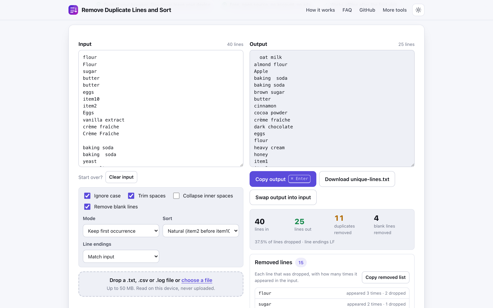
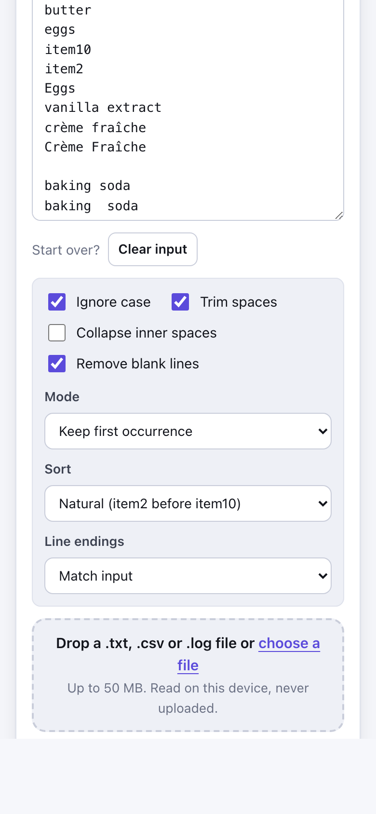

# Remove Duplicate Lines and Sort

> Remove duplicate lines, sort and clean a list in your browser, with a count of what was removed and nothing uploaded.

**🌐 Use it now: [turhe123.github.io/remove-duplicate-lines](https://turhe123.github.io/remove-duplicate-lines/)** · free · open source · runs in your browser · works offline


## Why

This is a free, open-source alternative to Dedupelist and TextFixer Remove Duplicate Lines. Tools in this space tend to come with ad-heavy pages, case and whitespace options that are missing or confusing, text that is sometimes processed on a server, and no way to see which lines were removed. This one keeps your files on your device, needs no account, shows no ads, has no limits and works offline. It can also be installed as an app from your browser.

## Screenshots

<p align="center"></p>

<p align="center"><em>Remove Duplicate Lines and Sort in the browser, light theme</em></p>

<p align="center"></p>

<p align="center"><em>Remove Duplicate Lines and Sort on a phone</em></p>

## Features

- Removes duplicate lines as you type; the output updates live, with a short debounce for large inputs.
- Comparison options:
  - Ignore case (on by default)
  - Trim leading and trailing spaces (on by default)
  - Collapse inner repeated spaces (off by default)
  - Remove blank lines (on by default)
- Four modes: keep first occurrence, keep last occurrence, only lines that were duplicated, only lines that appear once.
- Sorting: keep original order, A to Z, Z to A, natural (item2 before item10), length short to long, length long to short, reverse order, shuffle.
- Locale-aware sorting with the browser collator, so accented letters sort sensibly. Composed and decomposed accents (for example crème) match as duplicates.
- Result summary: lines in, lines out, duplicates removed and blank lines removed, plus the share of lines dropped.
- Collapsible **Removed lines** panel listing each dropped line with how many times it appeared, and a button to copy that list.
- Line endings: match the input (the most common ending is used when the input has mixed endings), or force LF or CRLF. A trailing newline does not create a phantom blank line.
- A hint appears when lines contain invisible characters (such as non-breaking or zero-width spaces) that make otherwise identical lines differ.
- Copy output (Ctrl+Enter, or Cmd+Enter on macOS), download it as `unique-lines.txt`, or swap the output back into the input.
- A "Load sample" button fills in a fictional bakery supply list.
- Large inputs (over about 200,000 lines) are processed in a Web Worker with a progress bar. The output box previews the first 5,000 lines of a very long result; Copy and Download always use the full result.
- Installable and offline-ready through a service worker; light and dark themes; layout works down to 390px wide.

**Input:** pasted text, or `.txt`, `.csv`, `.log` and `.tsv` files (dropped on the drop area or the text boxes, or chosen with the file picker). Files are limited to 50 MB each; larger ones show an error message instead of loading.
**Output:** plain text in the text box, the clipboard, or a downloaded `unique-lines.txt` (UTF-8).

## How to use

1. Paste your list into **Input**, or drop a `.txt`, `.csv` or `.log` file. Use **Load sample** to try it first.
2. Choose how lines are compared (ignore case, trim, collapse spaces, remove blanks) and pick a Mode and a Sort.
3. Check the counts and open **Removed lines** to see exactly what was dropped and how often it appeared.
4. Click **Copy output** or **Download unique-lines.txt**. Use **Swap output into input** to chain another pass.

## Privacy

- Nothing you paste or load is uploaded. All processing happens in your browser.
- No cookies.
- Page views are counted anonymously with [GoatCounter](https://www.goatcounter.com/), which is cookieless and open source.
- After the first visit the page is cached by a service worker, so it works offline.

## Run it locally

There is no build step.

```sh
git clone https://github.com/turhe123/remove-duplicate-lines
cd remove-duplicate-lines
python3 -m http.server 4173
```

Then open http://127.0.0.1:4173/

## Tests

```sh
npm i -D @playwright/test && npx playwright install chromium
npx playwright test
```

## Third-party code

None: browser APIs only.

## Built with AI

Remove Duplicate Lines and Sort was written by [Claude Code](https://claude.com/claude-code) inside an automated pipeline, from a plain-English spec. No code or assets from any commercial product were used; it is a clean-room implementation of a feature set, not a copy.

What that means in practice:

- The full source is in this repo under the MIT license. Read it before you trust it with your files.
- Everything runs in your browser. It makes no network requests except an anonymous, cookieless page-view count (GoatCounter); your files never leave the device.
- The page is tested headless in Chromium (Playwright) before every release, but it has had less human review than hand-written software. Bug reports and pull requests are welcome.

## Support ❤️

If this saved you time, you can support the work on Ko-fi: https://ko-fi.com/leodavidai

## More free web tools

Find more at https://turhe123.github.io/web-tools/

## License

MIT © Or Davidai Bachar
